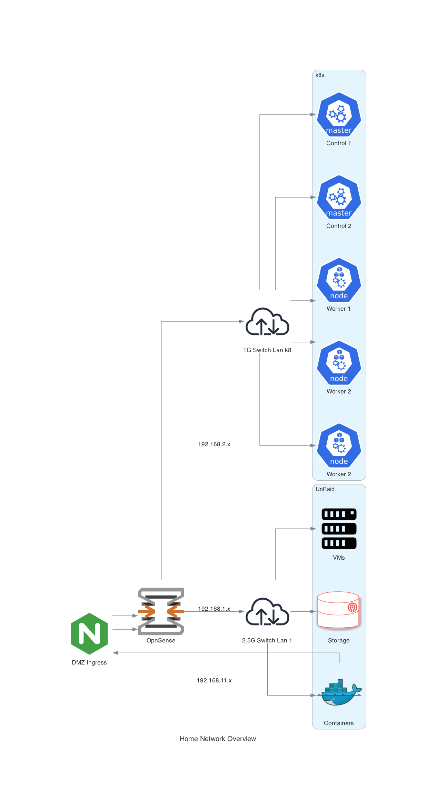
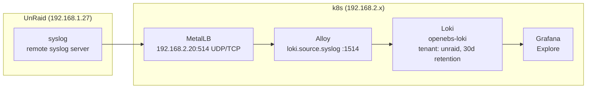

# Home Lab

This repository contains Infrastructure as Code for Kubernetes home clusters, templated from the [Flux2 Kustomize Helm Example](https://github.com/fluxcd/flux2-kustomize-helm-example).


## Tools and Technologies

* Talos Linux
* Fluxcd
* Helm
* Kustomize
* [Task](https://taskfile.dev/usage)
* [Sops](https://github.com/getsops/sops)
* [Pre-Commit](https://pre-commit.com/index.html)

## Repository Layout

* `clusters/{local,production}`: Flux entrypoints per cluster
* `infrastructure/{base,dependencies,local,production}`: infrastructure components (ingress, cert-manager, storage, backups, external-secrets)
* `apps/{base,local,production}`: applications
* `talos/`: SOPS-encrypted Talos machine configs and talosconfig
* `hacking/`: helper scripts and Ansible playbooks (Talos upgrade, k8s upgrade)
* `scripts/`: repo tooling used by pre-commit

Change cluster state by committing to git and letting Flux reconcile. Do not `kubectl apply` manifests by hand.

## Install Pre-Commit

```bash
pre-commit install
```

## Talos Linux

### Dashboard

```bash
task talos:den
talosctl --talosconfig /tmp/talosconfig.yaml dashboard --nodes 192.168.2.2
```

### Scale Up Cluster

```bash
talosctl apply-config --insecure \
    --nodes [NODE IP] \
    --file controlplane.yaml | worker.yaml
```

### Upgrade Talos OS

1. Update talos version in `hacking/ansible/talos-upgrade.yaml`
2. Run `task talos:upgrade`
3. Manually update worker and control files with new version: `sops --d --in-place talos/worker.yaml`
4. Commit and push changes

### Renew talosconfig

The admin client cert in `talos/talosconfig.yaml` expires after 1 year (current one: 2027-06-20). The `talosconfig-expiry` workflow opens an issue 60 days before that, and 365 days before the Talos CA expires. It only reads public certs, so it needs no secrets.

Renewal runs locally because it needs the PGP key and the Talos CA key, which must never be in CI:

```bash
task talos:renew
git commit -am 'chore(talos): renew talosconfig client cert'
```

This works even after the cert has expired. The nodes are not touched, since the CA is unchanged. If `kubectl` still complains afterwards, run `task talos:get_kubeconfig`.

### Generate Secrets

Generate `secrets.yaml` from control plane configuration:

```bash
talosctl gen secrets --from-controlplane-config controlplane-1.yaml
```

### Get Disk Information

```bash
talosctl get disks --nodes 192.168.2.2
```

## Kubernetes

Upgrade Kubernetes version:

Note: At times you need to run `brew install siderolabs/tap/talosctl` to upgrade talosctl CLI.

1. Test a dry run upgrade via: `talosctl --nodes 192.168.2.2 upgrade-k8s --to v1.37.1 --dry-run`
2. Run the actual upgrade: `talosctl --nodes 192.168.2.2 upgrade-k8s --to v1.37.1`
3. Update talos worker and control files via: `./hacking/k8-upgrade/update-sourcefiles.sh 1.37.1`
4. Commit and push changes

## Secrets

This project uses `SOPS` and the `external-secrets operator` with bit-warden as the secret store.

### SOPS

SOPS is used for encrypting files within the repo. This include the Talos config files.

For detailed information, see the [Flux SOPS guide](https://fluxcd.io/flux/guides/mozilla-sops/).


### External-Secrets Operator

The operator is used in conjunction with the [bitwarden-cli](https://github.com/umizoom/bitwarden-cli) container. All api keys, password etc use the operator.

The general idea is the Operator calls the bitwarden-cli via a GET to `http://bitwarden-cli.bitwarden.svc.cluster.local:8087/object/item/{{ .remoteRef.key }}`. The key is the ID of the secret in bit warden.

Only the pods in the namespace `external-secrets` can poll the `bitwarden-cli`. This is achieved via a `NetworkPolicy`.

The `bitwarden-cli` quries vault and returns the secret. The Operator then creates a K8s native `Secret` in the cluster based of the ExternalSecret spec.

For detailed information, see the [.](https://external-secrets.io/latest/examples/bitwarden/)


## Alerting

Prometheus evaluates alert rules and sends firing alerts to Alertmanager, which posts them to the `#lab-alerts` Discord channel. Resolved alerts are also posted. A still-firing alert is repeated every 24 hours.

Both live in the `prometheus` HelmRelease: `apps/production/prometheus/release.yaml` (rules under `serverFiles.alerting_rules.yml`, routing under `alertmanager.config`).

| Alert | Severity | Fires when |
| --- | --- | --- |
| `NodeNotReady` | critical | A node is not Ready for 2m |
| `ControlPlaneQuorumRisk` | critical | Fewer than 2 nodes are Ready (etcd quorum at risk) |
| `PodCrashLooping` | critical | A container is in CrashLoopBackOff for 5m |
| `NodeExporterDown` | warning | node-exporter on a node cannot be scraped for 2m |
| `PodNotReady` | warning | A pod is Pending, Unknown or Running-but-not-Ready for 15m (completed job pods are ignored) |
| `ContainerOOMKilled` | warning | A container was OOMKilled and restarted in the last 10m |
| `NodeHighMemory` / `NodeHighCPU` | warning | Node memory or CPU above 90% for 15m |
| `NodeDiskLow` | warning | Less than 10% free on `/var` for 15m |
| `K8upNoRecentBackup` | critical | No backup has completed in 36 hours |
| `K8upBackupErrors` | warning | The last restic backup of a volume reported errors (even if the k8up job shows Succeeded) |
| `K8upJobFailed` / `K8upScheduledJobFailing` | warning | A k8up backup, check or prune job failed |
| `PVCFull` | critical | A volume has less than 5% free for 15m |
| `PVCAlmostFull` | warning | A volume has less than 15% free for 15m |
| `MayastorPoolNotOnline` | critical | A Mayastor disk pool is degraded or faulted for 5m |
| `MayastorNodeOffline` | warning | A Mayastor node is offline for 5m |
| `MayastorPoolAlmostFull` | warning | A Mayastor pool is above 85% used for 30m |
| `ScrapeTargetDown` | warning | Unraid, OPNsense, Mayastor or k8up cannot be scraped for 5m |

While `NodeNotReady` is firing for a node, warning alerts for that node are suppressed, so one dead node produces one message instead of a flood.

The Discord webhook URL is stored in Bitwarden and delivered by an `ExternalSecret` (`apps/production/prometheus/external-secrets.yaml`) as the `alertmanager-discord` secret, which Alertmanager mounts as a file. It is never committed to git. Alertmanager `v0.28.1` is pinned because older versions cannot read a Discord webhook from a file.

Limitations:

* Prometheus and Alertmanager run on the cluster they watch. If the whole cluster or Prometheus is down, nothing is sent.
* Alertmanager has no persistent storage, so silences are lost when its pod restarts.
* `K8upNoRecentBackup` reads the backup time from the pushgateway. If the pushgateway restarts it loses that value and the alert stays silent until the next backup pushes it again.
* `PVCAlmostFull` and `PVCFull` skip `media-pvc` (a 50 TiB NFS share where a percentage means little) and the `openebs/*` volumes (they live on the node disk, which `NodeDiskLow` already covers).

### Test the pipeline

Send a fake alert straight to Alertmanager. It should show up in `#lab-alerts` after about 30 seconds and expires on its own after about 5 minutes:

```bash
task talos:den
kubectl port-forward svc/prometheus-alertmanager 9093:9093 &
curl -X POST localhost:9093/api/v2/alerts -H 'Content-Type: application/json' \
  -d '[{"labels":{"alertname":"TestAlert","severity":"info"},"annotations":{"summary":"test"}}]'
```

### Flux alerts

Flux reconcile failures go to the same `#lab-alerts` channel through the Flux notification-controller. A `Provider` (type `discord`) and an `Alert` (`flux-errors`, severity `error`) in `apps/production/notifications/` cover `GitRepository` and `Kustomization` objects in `flux-system` and `HelmRelease` objects in every namespace that has one. Event sources cannot be selected by namespace label, so when a new namespace gets a HelmRelease, add it to `flux-errors`.

The webhook comes from the same Bitwarden item through a second `ExternalSecret` in `flux-system` (`flux-discord-webhook`).

Send a fake Flux error event to check this path:

```bash
kubectl -n flux-system port-forward svc/notification-controller 8080:80 &
curl -X POST localhost:8080/ -H 'Content-Type: application/json' -d '{
  "involvedObject": {"kind":"Kustomization","name":"apps","namespace":"flux-system","apiVersion":"kustomize.toolkit.fluxcd.io/v1"},
  "severity":"error","reason":"Test","message":"test event","reportingController":"kustomize-controller",
  "timestamp":"'"$(date -u +%Y-%m-%dT%H:%M:%SZ)"'"}'
```

### Add or change a rule

1. Edit `serverFiles.alerting_rules.yml` in `apps/production/prometheus/release.yaml`.
2. Run the expression in the Prometheus UI first (`kubectl port-forward svc/prometheus-server 9090:80`) and check it returns series without its threshold, otherwise the alert may never fire.
3. Check the rules with `promtool check rules`. Pod-level alerts should carry a `node` label (join `kube_pod_info`) so `NodeNotReady` can suppress them.

## Flux

Build apps manifest:

```bash
flux build kustomization apps --path apps/local/
```

Build infra local manifest:

```bash
flux build kustomization infra-controllers-local --path infrastructure/local
```

Build without connecting to cluster:

```bash
flux build kustomization infra-dependencies --path infrastructure/dependencies \
--kustomization-file infrastructure/dependencies/kustomization.yaml \
--dry-run
```

Sync git repo:

```bash
flux reconcile source git flux-system
```


### Bootstrap Staging and Production

Set up environment variables:

```sh
export GITHUB_TOKEN=<your-token>
export GITHUB_USER=umizoom
export GITHUB_REPO=https://github.com/umizoom/homek8s
```

Bootstrap staging cluster:

```sh
flux bootstrap github \
    --context=kind-kind \
    --owner=${GITHUB_USER} \
    --repository=${GITHUB_REPO} \
    --branch=refactor \
    --personal \
    --path=clusters/local
```

Bootstrap production cluster:

```sh
flux bootstrap github \
    --owner=${GITHUB_USER} \
    --repository=${GITHUB_REPO} \
    --branch=main \
    --personal \
    --path=clusters/production
```

## Diagram



### Unraid syslog

Unraid forwards its syslog to the cluster so logs survive a hang or reboot (`/var/log` on Unraid is RAM). Alloy receives it and writes to Loki; read it in Grafana → Explore → `Loki Unraid` with `{job="unraid-syslog"}`.



Manifests are in `apps/production/syslog-alloy/`. In Unraid, set Settings → Syslog Server → Remote syslog server to `192.168.2.20`, port `514` (UDP or TCP).

### Omada controller

The Omada controller runs in the cluster (`apps/production/omada`) behind the MetalLB IP `192.168.2.21`. The two APs live on the `LAN` (`192.168.1.x`) interface, the cluster on `LANk8s` (`192.168.2.x`), so the traffic is routed by OPNsense.

- **Web UI:** `https://omada.basingse.ca` (nginx ingress, TLS to the backend), or `https://192.168.2.21:8043` directly.
- **Version:** the image tag must match the controller a backup is restored from (restores only work between identical versions).
- **Migrating from another controller:** in the old controller go to Settings > Migration > Controller Migration, export the settings, import them into the new controller, then run "Migrate Devices" so the APs are pointed at the new address.
- **New or factory-reset APs:** L2 broadcast discovery (UDP 29810) does not cross subnets, so a new AP cannot find the controller on its own. This is handled by a DHCP option on OPNsense:
  - Services > ISC DHCPv4 > `LAN` > Additional BOOTP/DHCP Options: Number `138`, Type `IP address`, Value `192.168.2.21` (the controller's MetalLB IP).
  - It only applies when a device takes a new lease. A new or reset AP then appears as Pending in the controller; click Adopt.
  - Fallback: enter `192.168.2.21` as the controller address on the AP's own web page.
  - If the controller's IP ever changes, update this option too.
- **Migrated APs:** the migration wizard points APs at `<ip>:8043` and they send UDP discovery packets to that port, which the Service maps to the pod's UDP 29810 listener. Keep that `8043/UDP` entry on the Service.
